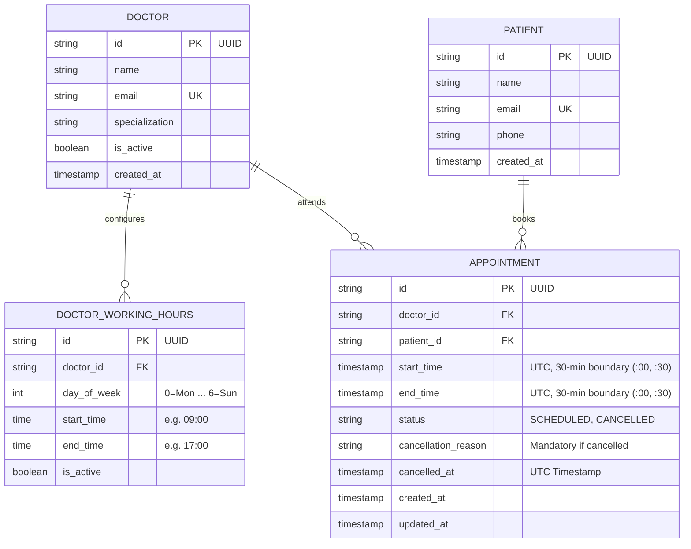
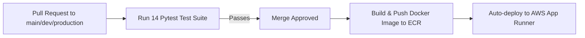

# Savannah Clinic Booking System API

[](https://github.com/GeraldWambui/savannah-clinic-booking-api/actions/workflows/ci-cd.yml)
[](https://hf5vyszv5v.us-east-1.awsapprunner.com)
[](https://www.python.org/)
[](https://fastapi.tiangolo.com/)
[](https://www.terraform.io/)
[](tests/)

A robust REST API for outpatient appointment scheduling, dynamic doctor availability, and concurrency-safe bookings. Built for the **Savannah Informatics Backend Developer Take-Home Assessment**.

---

## Submission Links

- **Live Deployed API:** [https://hf5vyszv5v.us-east-1.awsapprunner.com](https://hf5vyszv5v.us-east-1.awsapprunner.com)
- **Interactive Swagger Docs:** [https://hf5vyszv5v.us-east-1.awsapprunner.com/docs](https://hf5vyszv5v.us-east-1.awsapprunner.com/docs)
- **Health Check Endpoint:** [https://hf5vyszv5v.us-east-1.awsapprunner.com/health](https://hf5vyszv5v.us-east-1.awsapprunner.com/health)
- **GitHub Repository:** [https://github.com/GeraldWambui/savannah-clinic-booking-api](https://github.com/GeraldWambui/savannah-clinic-booking-api)

---

## Table of Contents

1. [Section 1: System Design](#section-1-system-design)
2. [Section 2: API Implementation & Local Setup](#section-2-api-implementation--local-setup)
3. [Section 3: Deployment & CI/CD](#section-3-deployment--cicd)
4. [Section 4: AI Reflection](#section-4-ai-reflection)

---

## Section 1: System Design

### 1. Scenario
A primary care clinic operates with 5 doctors. Patients schedule 30-minute consultation appointments online based on each doctor's recurring weekly shift hours. Booked slots must be immediately unavailable to others without risk of double-booking. Patients can cancel or reschedule appointments.

### 2. Architecture & Data Flow


1. **Clients:** Web/mobile clients communicate via HTTPS REST calls (`/docs` provides interactive OpenAPI testing).
2. **FastAPI Application Gateway:** Validates requests with Pydantic v2 schemas and attaches an `X-Request-ID` correlation header.
3. **Dynamic Availability Engine:** Calculates open 30-minute slots on the fly against doctor shift hours, excluding past times, active bookings, and enforcing the 1-hour booking cutoff.
4. **Atomic Booking Coordinator:** Manages transactional state transitions for booking, cancellation, and rescheduling.
5. **Relational Persistence (PostgreSQL / SQLite):** Enforces data integrity and concurrency safety via a partial unique index.

---

### 3. Data Models



---

### 4. Key Decisions & Trade-offs

#### A. Dynamic Slot Generation vs. Static Slot Pre-generation
- **Decision:** Generate 30-minute slots in-memory on demand when querying availability: `Available Slots = (Working Hours Slices) - (Active Appointments) - (Past Slots / 1h cutoff)`.
- **Why:** Pre-generating future slots in database rows creates maintenance bloat. If a doctor modifies shift hours, takes leave, or falls ill, thousands of future rows require costly database updates. In-memory generation takes sub-millisecond CPU time (< 1ms for 16 candidate slots) and guarantees zero data drift.

#### B. Concurrency Control & Double-Booking Prevention
- **Decision:** Enforce slot uniqueness at the database engine level using a **partial unique index**:
  ```sql
  CREATE UNIQUE INDEX uq_doctor_active_slot 
  ON appointments (doctor_id, start_time) 
  WHERE status != 'CANCELLED';
  ```
- **Why:** Application-level checks (`if slot_taken`) fail under high concurrency due to **Time-of-Check to Time-of-Use (TOCTOU)** race conditions. The database partial unique index rejects simultaneous duplicate inserts with an integrity violation. The API catches this violation and returns `409 Conflict`.
- **Verification:** Verified by `tests/test_concurrency.py` using 5 concurrent threads hitting the exact same slot simultaneously: 1 succeeds (`201`), 4 fail safely (`409`).

#### C. Atomic Rescheduling with Rollback Safety
- **Decision:** Execute rescheduling inside a single database transaction. The existing appointment's `start_time` and `end_time` are updated in place only after validating the target slot.
- **Why:** Two-step rescheduling (cancelling old appointment then booking new) risks leaving a patient stranded with no appointment if the new slot fails. In-place transactional update ensures that if the target slot fails validation or is contested, the transaction rolls back cleanly, keeping the original appointment intact.

#### D. Soft Cancellation with Auditability
- **Decision:** Appointments are never hard-deleted. They transition from `SCHEDULED` to `CANCELLED` with a required `cancellation_reason` and `cancelled_at` timestamp.
- **Why:** Medical scheduling requires audit history. Because the partial unique index filters on `WHERE status != 'CANCELLED'`, cancelling immediately restores the slot for new patient bookings.

---

## Section 2: API Implementation & Local Setup

### 1. API Endpoints

All endpoints are available at the root and under `/api/v1`.

| Method | Endpoint | Description | Success | Error Codes |
| :--- | :--- | :--- | :--- | :--- |
| `POST` | `/appointments` | Book a 30-minute slot | `201 Created` | `400`, `404`, `409 Conflict` |
| `GET` | `/doctors/{id}/availability` | List open 30-min slots for doctor on date | `200 OK` | `400`, `404 Not Found` |
| `PATCH` | `/appointments/{id}/cancel` | Cancel appointment with reason | `200 OK` | `400`, `404`, `422 Unprocessable` |
| `PATCH` | `/appointments/{id}/reschedule` | Move appointment to a new slot atomically | `200 OK` | `400`, `404`, `409 Conflict` |
| `GET` | `/patients/{id}/appointments` | **(Bonus)** List patient's upcoming appointments | `200 OK` | `404 Not Found` |
| `GET` | `/health` | Liveness & health probe | `200 OK` | `500 Server Error` |

#### Booking Constraints & Validations:
- Slots must fall strictly within the doctor's active shift hours.
- Slots must align to 30-minute boundaries (`:00` or `:30`).
- Appointments cannot be booked in the past.
- **Bonus:** Appointments cannot be booked within 1 hour of current time.
- Cancellation requires a non-empty `reason` string and rejects already-cancelled appointments.

---

### 2. Local Setup & Running

#### Option A: Python Virtual Environment
```bash
# 1. Clone repo
git clone https://github.com/GeraldWambui/savannah-clinic-booking-api.git
cd savannah-clinic-booking-api

# 2. Virtual environment setup
python3.12 -m venv venv
source venv/bin/activate
pip install -r requirements.txt

# 3. Migrations & Seeding (5 doctors + working hours + test patients)
alembic upgrade head
python scripts/seed_data.py

# 4. Start local development server
uvicorn app.main:app --host 0.0.0.0 --port 8000 --reload
```
Interactive docs: [http://localhost:8000/docs](http://localhost:8000/docs)

#### Option B: Docker Compose
```bash
docker-compose up --build
```
Boots PostgreSQL 16, runs Alembic migrations, seeds doctors, and serves API at port `8000`.

---

### 3. Automated Test Suite

Run the 14-test Pytest suite:
```bash
pytest -v
```

```
tests/test_availability.py::test_get_doctor_availability_weekday PASSED
tests/test_availability.py::test_get_doctor_availability_weekend_empty PASSED
tests/test_availability.py::test_availability_excludes_booked_slot_and_restores_on_cancel PASSED
tests/test_availability.py::test_doctor_not_found PASSED
tests/test_availability.py::test_health_and_request_id_tracing PASSED
tests/test_booking.py::test_book_appointment_success PASSED
tests/test_booking.py::test_book_appointment_outside_working_hours PASSED
tests/test_booking.py::test_book_appointment_invalid_boundary PASSED
tests/test_booking.py::test_book_appointment_in_the_past PASSED
tests/test_booking.py::test_book_appointment_duplicate_returns_409 PASSED
tests/test_booking.py::test_cancel_appointment_lifecycle PASSED
tests/test_booking.py::test_reschedule_appointment_lifecycle PASSED
tests/test_booking.py::test_patient_upcoming_appointments_bonus PASSED
tests/test_concurrency.py::test_concurrent_booking_race_condition_prevention PASSED
```

---

## Section 3: Deployment & CI/CD

### 1. Live Deployment Details
- **Public URL:** [https://hf5vyszv5v.us-east-1.awsapprunner.com](https://hf5vyszv5v.us-east-1.awsapprunner.com)
- **Cloud Provider:** **AWS App Runner** (fully managed serverless container runtime) + **Amazon ECR** (Elastic Container Registry).
- **Free-Tier Compliant:** 1 vCPU, 2 GB RAM, automatic HTTPS certificate provisioning, and container health checking via `/health`.

### 2. CI/CD Pipeline (`.github/workflows/ci-cd.yml`)

The repository uses **GitHub Actions** to automate quality checks and deployments:



- **Trigger 1 — Pull Requests (Testing Quality Gate):**
  - Runs on every pull request targeting `main`, `dev`, or `production`.
  - Executes the full 14-test Pytest suite (including concurrency race condition tests). Merging is blocked if any test fails.
- **Trigger 2 — Push / Merge (Continuous Deployment):**
  - Triggers on push or merge into `main` or `dev`.
  - Authenticates to AWS using GitHub Secrets, builds the Docker container, pushes to Amazon ECR, and triggers zero-downtime deployment on AWS App Runner.

### 3. Terraform (IaC) AWS Module

All AWS infrastructure is codified in [`terraform/`](terraform/):
- `aws_ecr_repository.clinic_ecr`: Container registry with scan-on-push.
- `aws_iam_role.apprunner_ecr_role`: Least-privilege IAM access role for App Runner.
- `aws_apprunner_service.clinic_service`: Managed container service with health checks.

To provision:
```bash
cd terraform
cp terraform.tfvars.example terraform.tfvars
terraform init
terraform apply
```

---

## Section 4: AI Reflection

### 1. What did you use AI for across the four sections?
- **Section 1 (System Design):** Comparing edge-case trade-offs between database range exclusion constraints (GiST) vs. partial unique index constraints.
- **Section 2 (Implementation):** Generating initial Pydantic schema boilerplate and database seed fixtures for the 5 doctors.
- **Section 3 (Deployment & CI/CD):** Scaffolding AWS App Runner Terraform resource blocks and GitHub Actions workflow syntax.
- **Section 4 (Testing):** Drafting multithreaded concurrency test templates (`concurrent.futures.ThreadPoolExecutor`).

### 2. Give one example where an AI suggestion improved your work. What did you prompt it with?
- **Prompt:**  
  *"How should I model doctor working hours in a relational database for recurring weekly shifts to keep slot calculation fast without periodic batch cron jobs?"*
- **Outcome:**  
  The AI suggested modeling working hours using integer weekdays (`0=Monday ... 6=Sunday`) with `start_time` and `end_time` columns rather than fixed calendar dates. This kept the working hours table under 50 rows total and enabled sub-millisecond dynamic slot computation.

### 3. Give one example where AI output was wrong or incomplete and how you caught it.
- **The Flaw:**  
  When asked to generate the booking logic, the AI produced a naive application-level check:
  ```python
  existing = db.query(Appointment).filter_by(doctor_id=doc_id, start_time=slot, status="SCHEDULED").first()
  if existing:
      raise HTTPException(400, "Already taken")
  db.add(new_appointment)
  db.commit()
  ```
- **How It Was Caught:**  
  This pattern contains a classic **Time-of-Check to Time-of-Use (TOCTOU)** race condition. Two concurrent requests arriving at the same millisecond both pass the `if existing` check and both insert, causing double-booking.  
  I caught this by running a dedicated multithreaded test (`tests/test_concurrency.py`). I resolved it by enforcing a database-level partial unique index (`uq_doctor_active_slot` on `(doctor_id, start_time) WHERE status != 'CANCELLED'`) and handling the resulting `IntegrityError` with a transaction rollback and `409 Conflict` response.

### 4. Name two decisions you made without AI. Why did you trust your own judgment there?
1. **Dynamic In-Memory Slot Slicing over Static Slot Pre-generation:**  
   AI tools often default to creating a `Slot` entity table with boolean `is_available` flags because that pattern is common in novice tutorials. Pre-generating slots creates severe operational overhead: shift changes, sick days, or holidays require cascading database updates. Calculating availability on-the-fly from recurring rules minus active bookings is clean, deterministic, and requires zero maintenance storage.
2. **Atomic In-Place Rescheduling with Rollback Safety:**  
   Common AI suggestions implement rescheduling by first cancelling the existing appointment and then creating a new one. If the second booking fails (due to a concurrent collision or validation error), the patient is left with a cancelled appointment and no booking. I enforced an in-place atomic update inside a single transaction so that any failure automatically rolls back, preserving the patient's original appointment.
