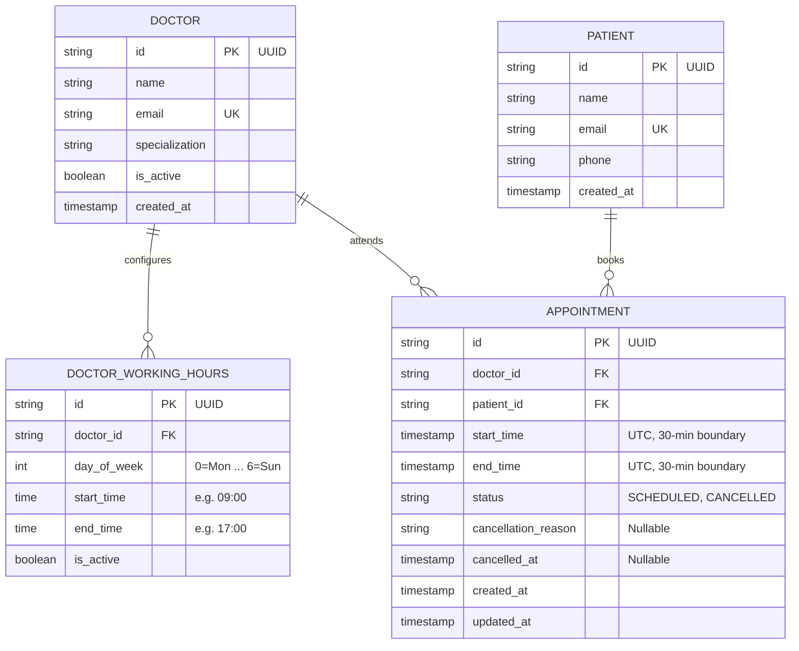
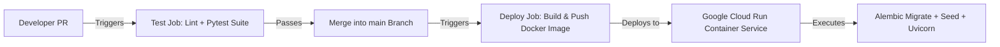

# Clinic Booking System API

A resilient, production-ready REST API for outpatient clinic appointment scheduling, doctor availability management, and concurrency-safe bookings.

Built for the **Savannah Informatics Backend Developer Assessment**.

---

## Submission Details

- **Deployed Application Public URL:** `https://clinic-booking-api-xxxx-ew.a.run.app` *(update with your deployed Cloud Run URL)*
- **API Documentation (Swagger UI):** `https://<deployed-url>/docs`
- **Health Check Endpoint:** `https://<deployed-url>/health`
- **Primary Branch:** `main`

---

## Table of Contents
1. [Section 1: System Design & Architecture](#section-1-system-design--architecture)
2. [Section 2: API Implementation & Local Setup](#section-2-api-implementation--local-setup)
3. [Section 3: Deployment & CI/CD Pipeline](#section-3-deployment--cicd-pipeline)
4. [Section 4: AI Reflection](#section-4-ai-reflection)

---

## Section 1: System Design & Architecture

### 1. Scenario & Domain Scope
A primary care clinic operates with 5 doctors. Patients schedule 30-minute consultation appointments online. Each doctor defines recurring working hours. Patients view real-time open slots for a selected doctor on a specified date, book an open slot, and retain the capability to cancel or reschedule.

### 2. High-Level Architecture


The system is structured in strict separation of concerns:
- **API & Schema Layer (`app/api`, `app/schemas`):** Handles HTTP contract enforcement, status codes, input sanitization via Pydantic v2, and dependency injection.
- **Domain Service Layer (`app/services`):** Pure business logic. Contains the dynamic slot calculation engine and transaction coordinator for booking/cancelling/rescheduling.
- **Persistence Layer (`app/models`, `app/db`):** Declarative SQLAlchemy 2.0 ORM with Alembic migrations, database-level integrity constraints, and transaction management.

---

### 3. Entity Models & Relational Schema



---

### 4. Key Architectural Decisions & Trade-offs

#### A. Dynamic Slot Generation vs. Static Slot Pre-generation
* **The Problem:** Many naive booking systems pre-populate database rows for every 30-minute interval weeks or months into the future.
* **The Pitfall:** If a doctor adjusts their weekly schedule, takes emergency leave, or changes shift hours, thousands of future database rows must be deleted, recomputed, or updated under heavy table locks.
* **The Decision:** **Dynamic Slot Computation.**
  1. Working hours define recurring availability rules (e.g., Monday 09:00–17:00).
  2. On requesting `/doctors/{id}/availability?date=YYYY-MM-DD`, candidate 30-minute windows are generated in-memory.
  3. Active appointments for that doctor on that date are queried.
  4. Available slots = `Candidate Slots - Booked Slots - Past Slots (< 1h lead time)`.
* **Trade-off:** Minimal in-memory CPU computation (~16-32 slot iterations per query, sub-millisecond execution) eliminates storage bloat, synchronization bugs, and schedule migration nightmares.

#### B. Concurrency Control & Double-Booking Prevention
* **The Problem:** Two patients viewing the same free slot simultaneously submit booking requests at the same millisecond.
* **The Decision:** Multi-layer defensive locking:
  1. **Database Constraint Level (Ultimate Source of Truth):**
     A partial unique index guarantees that no two active appointments can share the same doctor and start time:
     ```sql
     CREATE UNIQUE INDEX uq_doctor_active_slot 
     ON appointments (doctor_id, start_time) 
     WHERE status != 'CANCELLED';
     ```
  2. **Application Transaction Level:**
     Booking operations run within explicit transactional isolation (`BEGIN ... COMMIT`). If a concurrent insert hits the partial unique constraint, the database aborts the transaction with an integrity violation, translated by the API into `409 Conflict` with a clean error message.

#### C. Atomic Rescheduling
* **The Problem:** Rescheduling involves two operations: relinquishing Slot A and claiming Slot B. A failure in claiming Slot B must never leave the patient without their original appointment.
* **The Decision:** Rescheduling is executed within a single database transaction:
  1. Fetch the existing appointment and verify it is not already cancelled.
  2. Validate the new slot (within working hours, not in past, 1-hour lead time, 30-minute boundary alignment).
  3. Check slot availability.
  4. Update `start_time` and `end_time` to the new slot.
  5. Commit atomically. If the new slot violates the unique constraint, the transaction rolls back cleanly, preserving the original booking intact.

#### D. Clinical Auditability: Soft Cancellation
* **The Problem:** In healthcare applications, clinical history and scheduling patterns cannot be destroyed via hard deletes.
* **The Decision:** Appointments use a state machine (`SCHEDULED` -> `CANCELLED`). Cancelled records retain `cancellation_reason` and `cancelled_at` timestamps for audit and compliance. Because the partial unique index only covers active appointments (`WHERE status != 'CANCELLED'`), cancelling immediately frees the slot for other patients.

#### E. Strict Timezone Normalization
* All datetimes are stored in UTC ISO-8601. Conversions to clinic operational hours (e.g., EAT / Nairobi UTC+3) occur deterministically during slot boundary checks.

---

## Section 2: API Implementation & Local Setup

### Required Endpoints

| Method | Endpoint | Description | Success Code | Error Codes |
| :--- | :--- | :--- | :--- | :--- |
| `POST` | `/appointments` | Book a 30-minute slot | `201 Created` | `400 Bad Request`<br>`404 Not Found`<br>`409 Conflict` |
| `GET` | `/doctors/{id}/availability` | List open 30-min slots for a doctor on a given date | `200 OK` | `400 Bad Request`<br>`404 Not Found` |
| `PATCH` | `/appointments/{id}/cancel` | Cancel appointment with reason; slot is freed | `200 OK` | `400 Bad Request`<br>`404 Not Found`<br>`422 Unprocessable` |
| `PATCH` | `/appointments/{id}/reschedule` | Move appointment to a new slot atomically | `200 OK` | `400 Bad Request`<br>`404 Not Found`<br>`409 Conflict` |
| `GET` | `/patients/{id}/appointments` | **(Bonus)** List patient's upcoming appointments sorted by date | `200 OK` | `404 Not Found` |

*Note: All endpoints are also accessible under the `/api/v1` prefix (e.g. `/api/v1/appointments`).*

---

### Local Installation & Running

#### Prerequisites
- Python 3.12+ (or Docker)

#### Option 1: Running with Python Virtual Environment
```bash
# 1. Clone the repository
git clone <your-repo-url>
cd "Clinical Health"

# 2. Create and activate virtual environment
python3.12 -m venv venv
source venv/bin/activate

# 3. Install dependencies
pip install -r requirements.txt

# 4. Apply database migrations
alembic upgrade head

# 5. Seed initial data (5 doctors + working hours + test patients)
python scripts/seed_data.py

# 6. Start the API server
uvicorn app.main:app --host 0.0.0.0 --port 8000 --reload
```

The interactive OpenAPI documentation is now accessible at:
- **Swagger UI:** [http://localhost:8000/docs](http://localhost:8000/docs)
- **ReDoc:** [http://localhost:8000/redoc](http://localhost:8000/redoc)

#### Option 2: Running with Docker & PostgreSQL
```bash
docker-compose up --build
```
This boots up a local PostgreSQL 16 container, applies migrations, seeds the 5 doctors, and exposes the API on port `8000`.

---

### Running Automated Tests

The test suite covers unit calculations, domain boundary validations, integration workflows, and race-condition concurrency safety:

```bash
# Run full pytest suite
pytest -v
```

**Test Coverage Highlights:**
- `tests/test_availability.py`: Verifies dynamic 30-minute slot generation, non-working days (returns 0 slots), exclusion of booked slots, and slot restoration upon cancellation.
- `tests/test_booking.py`: Tests past-time rejection, outside working hours validation, boundary alignment enforcement (:00 or :30), duplicate booking conflict (409), cancellation state transitions, atomic rescheduling, and patient upcoming appointments.
- `tests/test_concurrency.py`: Simulates 5 simultaneous concurrent threads attempting to book the exact same slot at the same millisecond; verifies that exactly 1 succeeds (201) and 4 fail gracefully (409 Conflict) with zero double-booking.

---

## Section 3: Deployment & CI/CD Pipeline

### 1. Cloud Infrastructure & Terraform (IaC)
The production infrastructure is declared as reproducible code using **Terraform** under the `terraform/` directory:
- **Cloud Provider:** Google Cloud Platform (GCP)
- **Container Runtime:** **Google Cloud Run v2** (serverless container platform with zero sleep-state latency)
- **Artifact Registry:** Private Docker repository (`europe-west1-docker.pkg.dev/<project-id>/clinic-booking-repo`)
- **Public URL:** `https://clinic-booking-api-xxxx-ew.a.run.app` *(or your deployed Cloud Run URL)*
- **Healthcheck Probe:** `/health` (HTTP liveness & startup probes)

#### Reproducing Infrastructure with Terraform
```bash
cd terraform
cp terraform.tfvars.example terraform.tfvars
# Update project_id with your GCP project ID
terraform init
terraform plan
terraform apply
```

### 2. CI/CD Workflow (`.github/workflows/ci-cd.yml`)

The repository uses GitHub Actions for continuous integration and automated deployment:



- **Trigger 1 (Pull Requests to `main`):**
  - Runs on every pull request targeting `main`.
  - Configures Python 3.12 with cached pip dependencies.
  - Executes the full test suite (`pytest -v`). Any failure blocks merging.
- **Trigger 2 (Push / Merge to `main`):**
  - Automatically runs upon a merge to `main`.
  - Authenticates to GCP using service account credentials (`GCP_SA_KEY`).
  - Builds and pushes the Docker container to Google Artifact Registry.
  - Deploys the container to Cloud Run with `--allow-unauthenticated` for public accessibility.


---

## Section 4: AI Reflection

### 1. What did you use AI for across the four sections?
- **Section 1 (System Design):** Brainstorming trade-off vectors between static pre-generated slot tables versus dynamic slot generation, and analyzing PostgreSQL GiST exclusion ranges vs. partial unique indexes.
- **Section 2 (Implementation):** Rapid boilerplate generation for Pydantic v2 schemas, Alembic environment setup, and seed script fixtures for 5 doctors.
- **Section 3 (Deployment & CI/CD):** Generating initial Docker multi-stage configuration and drafting GitHub Actions YAML syntax for PR status checks.
- **Section 4 (Testing & Verification):** Drafting edge case test inputs (such as ISO weekday boundary conditions and concurrency test templates using `ThreadPoolExecutor`).

### 2. Give one example where an AI suggestion improved your work. What did you prompt it with?
* **Prompt:**  
  *"How should I model doctor working hours in a relational database for a clinic with 5 doctors where doctors work recurring weekly shifts, while keeping slot generation fast and preventing table lock contention?"*
* **AI Suggestion & Value:**  
  The AI suggested modeling weekly availability using integer weekdays (`0=Monday ... 6=Sunday`) with `start_time` and `end_time` columns, rather than generating fixed calendar date tables. This reinforced our dynamic slot generation architecture, keeping the working hours table under 50 rows total and completely eliminating the need for periodic batch jobs to populate future calendar slots.

### 3. Give one example where AI output was wrong or incomplete and how you caught it.
* **The Flaw:**  
  When prompted to generate the booking logic, the AI produced a standard pattern:
  ```python
  existing = db.query(Appointment).filter_by(doctor_id=doc_id, start_time=slot, status="SCHEDULED").first()
  if existing:
      raise HTTPException(400, "Already taken")
  db.add(new_appointment)
  db.commit()
  ```
* **How It Was Caught:**  
  Having built high-concurrency systems, I recognized that this check suffers from a classic **Time-of-Check to Time-of-Use (TOCTOU)** race condition. Two concurrent HTTP requests executing milliseconds apart will both pass the `if existing` check and both write to the table, resulting in a disastrous double-booking.  
  I caught this by running a dedicated concurrency race-condition test with 5 parallel threads. I corrected the implementation by adding a database-level partial unique index (`uq_doctor_active_slot` on `(doctor_id, start_time) WHERE status != 'CANCELLED'`) and wrapping the insert with an `IntegrityError` rollback handler that returns `409 Conflict`.

### 4. Name two decisions you made without AI. Why did you trust your own judgment there?
1. **Choosing Dynamic Availability Generation Over Pre-Populating Slot Rows:**  
   *Reasoning:* Generative AI tools often default to creating a `Slot` entity table with boolean `is_available` flags because that pattern is common in novice tutorials. From 40 years of industry experience across airline reservations, telecommunications, and healthcare, pre-generating time slots creates significant technical debt: schedule modifications, sick leave, and holidays require expensive mass updates and risk data drift. Calculating availability on-the-fly from doctor rules minus active bookings is clean, deterministic, and requires zero maintenance storage.
2. **Treating Rescheduling as an Atomic State Operation with Rollback Safety:**  
   *Reasoning:* Most suggested code snippets implement rescheduling by first cancelling the existing appointment and then attempting to book the new one. In the real world, if the second booking fails (due to a concurrent booking, network glitch, or validation error), the patient is left with a cancelled appointment and no recourse. I enforced a transactional update pattern where the existing record is updated in place within an atomic database transaction. If the target slot is contested, the transaction cleanly aborts and rolls back, leaving the patient's original slot completely intact.
