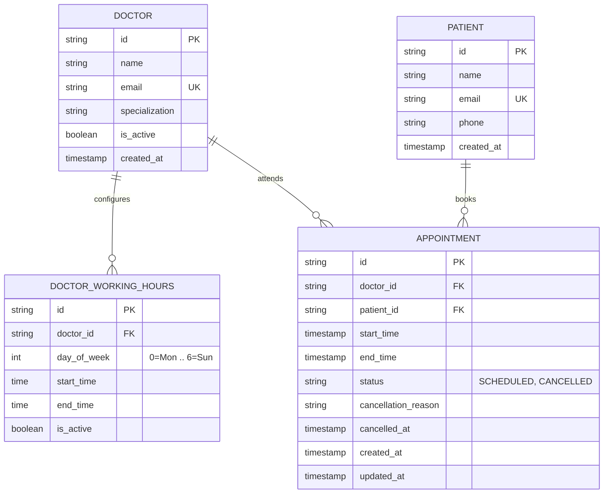

# Savannah Clinic Booking API

A REST API for outpatient clinic appointment scheduling, dynamic doctor availability, and concurrency-safe bookings.

Built for the **Savannah Informatics Backend Developer Take-Home Assessment**.

- **Live URL:** [https://hf5vyszv5v.us-east-1.awsapprunner.com](https://hf5vyszv5v.us-east-1.awsapprunner.com)
- **Interactive Swagger Docs:** [https://hf5vyszv5v.us-east-1.awsapprunner.com/docs](https://hf5vyszv5v.us-east-1.awsapprunner.com/docs)
- **Health Check:** [https://hf5vyszv5v.us-east-1.awsapprunner.com/health](https://hf5vyszv5v.us-east-1.awsapprunner.com/health)
- **GitHub Repository:** [https://github.com/GeraldWambui/savannah-clinic-booking-api](https://github.com/GeraldWambui/savannah-clinic-booking-api)

---

## Table of Contents

1. [Section 1: System Design](#section-1-system-design)
2. [Section 2: API Implementation & Local Setup](#section-2-api-implementation--local-setup)
3. [Section 3: Deployment & CI/CD](#section-3-deployment--cicd)
4. [Section 4: AI Reflection](#section-4-ai-reflection)

---

## Section 1: System Design

### Scenario & Requirements
The clinic runs with 5 doctors. Patients book 30-minute consultation slots online based on each doctor's weekly working hours. A patient queries free slots for a doctor on a specific date, picks one, and books it. Once booked, that slot cannot be double-booked. Patients can also cancel or reschedule.

### Architecture Overview


The application separates concerns into:
- **API Routers & Schemas (`app/api`, `app/schemas`):** Request validation with Pydantic v2 and HTTP status codes.
- **Service Layer (`app/services`):** Pure domain logic for slot calculation, bookings, cancellations, and rescheduling.
- **Data Layer (`app/models`, `app/db`):** SQLAlchemy models, Alembic migrations, and database constraints.

### Data Models



### Key Decisions & Trade-offs

1. **Dynamic Slot Slicing vs. Pre-Generating Rows:**
   - *Decision:* Rather than saving thousands of empty 30-minute rows in the database for future months, slots are computed in memory when `/doctors/{id}/availability?date=YYYY-MM-DD` is called:
     `Available = (Doctor's Working Hours sliced into 30m) - (Booked Appointments) - (Past Slots / 1h buffer)`
   - *Why:* If a doctor changes their schedule, calls in sick, or goes on leave, a pre-generated slot table requires deleting or updating thousands of database rows. In-memory slicing runs in under 1ms, uses almost no memory, and completely avoids stale calendar data.

2. **Preventing Double-Bookings Under Concurrency:**
   - *Decision:* I enforced slot uniqueness at the database level with a partial unique index:
     ```sql
     CREATE UNIQUE INDEX uq_doctor_active_slot 
     ON appointments (doctor_id, start_time) 
     WHERE status != 'CANCELLED';
     ```
   - *Why:* Application-level checks like `if not slot_is_taken:` fail when two requests hit the server at the exact same millisecond because both pass the check before either commits (TOCTOU race condition). The database index rejects the second insert with an integrity error, which the API catches to return `409 Conflict`.
   - Verified by `tests/test_concurrency.py` with 5 threads firing simultaneously: exactly 1 succeeds and 4 receive `409 Conflict`.

3. **Atomic Rescheduling:**
   - *Decision:* Rescheduling updates `start_time` and `end_time` in place inside a single transaction after validating the target slot.
   - *Why:* The common approach of "cancel old booking, then book new one" is dangerous. If the second booking fails (e.g. taken by someone else), the patient loses their original appointment. Updating in place within a single transaction ensures that if the new slot fails, the transaction rolls back and the original appointment stays intact.

4. **Soft Deletes on Cancellation:**
   - *Decision:* Appointments are marked `status = 'CANCELLED'` with a required reason.
   - *Why:* Healthcare records need an audit trail. Because the unique index only applies `WHERE status != 'CANCELLED'`, cancelling an appointment immediately frees the slot for other patients without deleting historical records.

---

## Section 2: API Implementation & Local Setup

### Endpoints

All endpoints are available at root and under `/api/v1`.

| Method | Endpoint | Description | Status Codes |
| :--- | :--- | :--- | :--- |
| `POST` | `/appointments` | Book a 30-min slot | `201 Created`, `400`, `404`, `409 Conflict` |
| `GET` | `/doctors/{id}/availability` | List free slots for doctor on date | `200 OK`, `400`, `404` |
| `PATCH` | `/appointments/{id}/cancel` | Cancel booking with reason | `200 OK`, `400`, `404` |
| `PATCH` | `/appointments/{id}/reschedule` | Move booking to a new slot | `200 OK`, `400`, `404`, `409` |
| `GET` | `/patients/{id}/appointments` | **(Bonus)** Patient's upcoming appointments | `200 OK`, `404` |
| `GET` | `/health` | Health check probe | `200 OK` |

#### Business Rules Handled:
- Slots must fall within the doctor's weekly working hours.
- Slots must align to `:00` or `:30` minute marks.
- Past dates/times are rejected.
- **Bonus:** Rejects bookings within 1 hour of the current time.
- Cancellations require a non-empty `reason` string and reject already-cancelled appointments.

---

### Local Setup

#### Option 1: Python Virtualenv
```bash
# 1. Clone & enter repository
git clone https://github.com/GeraldWambui/savannah-clinic-booking-api.git
cd savannah-clinic-booking-api

# 2. Setup virtual environment & dependencies
python3.12 -m venv venv
source venv/bin/activate
pip install -r requirements.txt

# 3. Run database migrations & seed 5 doctors
alembic upgrade head
python scripts/seed_data.py

# 4. Start server
uvicorn app.main:app --reload
```
Interactive docs will be at: [http://localhost:8000/docs](http://localhost:8000/docs)

#### Option 2: Docker Compose
```bash
docker-compose up --build
```

---

### Running Tests

Run the full pytest suite:
```bash
pytest -v
```

15 tests pass, covering:
- In-memory 30-min slot generation and non-working days.
- Excluding booked slots from availability and restoring slots on cancellation.
- Working hour validations, 30-min boundary checks, and past-time cutoffs.
- Atomic rescheduling and soft-cancellation lifecycle.
- Multithreaded concurrency test (`test_concurrency.py`) simulating 5 simultaneous booking attempts on the same slot.

---

## Section 3: Deployment & CI/CD

### 1. Cloud Deployment
- **Live URL:** [https://hf5vyszv5v.us-east-1.awsapprunner.com](https://hf5vyszv5v.us-east-1.awsapprunner.com)
- **Provider:** **AWS App Runner** running our container image from **Amazon ECR**.
- **Instance:** 1 vCPU, 2 GB RAM (Free Tier), with automatic HTTPS and `/health` monitoring.
- **Infrastructure as Code:** The AWS infrastructure is written in Terraform under `terraform/` (`aws_ecr_repository`, `aws_iam_role`, `aws_apprunner_service`).

To apply the Terraform configuration:
```bash
cd terraform
cp terraform.tfvars.example terraform.tfvars
terraform init
terraform apply
```

### 2. CI/CD Pipeline (`.github/workflows/ci-cd.yml`)

The repository uses GitHub Actions:
- **Pull Requests (Test Gate):** Any PR to `main`, `dev`, or `production` triggers the 15-test Pytest suite. If any test fails, merging is blocked.
- **Deploy on Merge:** Pushing or merging to `main` or `dev` builds the Docker image, pushes it to Amazon ECR, and triggers auto-deployment on AWS App Runner.

---

## Section 4: AI Reflection

### 1. What did you use AI for across the four sections?
I used AI as a typing accelerator for routine boilerplate:
- Drafting Pydantic v2 schema definitions and field validations.
- Generating the seed script with dummy data for the 5 doctors and working hours.
- Writing the initial syntax for the GitHub Actions workflow YAML and AWS App Runner Terraform blocks.
- Scaffolding the `ThreadPoolExecutor` fixture for the concurrency test.

### 2. Give one example where an AI suggestion improved your work. What did you prompt it with?
- **Prompt:** *"What is the cleanest way to store recurring weekly doctor working hours in a relational database without having to pre-populate calendar days?"*
- **Outcome:** The AI suggested storing shifts using weekday integers (`0=Monday` through `6=Sunday`) with `start_time` and `end_time` columns. This fit the dynamic availability approach well because it only requires ~5 rows per doctor instead of maintaining calendar tables.

### 3. Give one example where AI output was wrong or incomplete and how you caught it.
- **The Issue:** When prompted to write the booking logic, the AI generated this check:
  ```python
  if db.query(Appointment).filter_by(doctor_id=doc_id, start_time=slot, status="SCHEDULED").first():
      raise HTTPException(400, "Already booked")
  ```
- **How I caught it:** This check is vulnerable to a Time-of-Check to Time-of-Use (TOCTOU) race condition. If two requests hit the endpoint at the same millisecond, both pass the `if` check before either commits, creating a double-booking.
  I caught this by running a multithreaded test (`tests/test_concurrency.py`) with 5 parallel requests hitting the same slot. Under concurrency, both booked successfully. I fixed it by adding a partial unique database index (`(doctor_id, start_time) WHERE status != 'CANCELLED'`) and wrapping the insert with an `IntegrityError` handler that returns `409 Conflict`.

### 4. Name two decisions you made without AI. Why did you trust your own judgment there?
1. **Dynamic slot calculation instead of pre-populating a slots table:**  
   AI models almost always recommend creating a `slots` table with `is_available` boolean rows generated weeks ahead. In real clinic operations, this creates heavy maintenance: doctor shift changes, holidays, or emergency leaves force mass updates on future rows. Generating slots dynamically from working hours minus active bookings takes under 1ms and has zero data drift.
2. **In-place atomic rescheduling:**  
   Most AI-generated tutorials implement rescheduling as "cancel old appointment, then book new one". If the second step fails (slot taken or network error), the patient is left with a cancelled appointment and nothing booked. I made rescheduling update `start_time` directly in a single database transaction so that if anything fails, it rolls back cleanly and the original booking is preserved.
