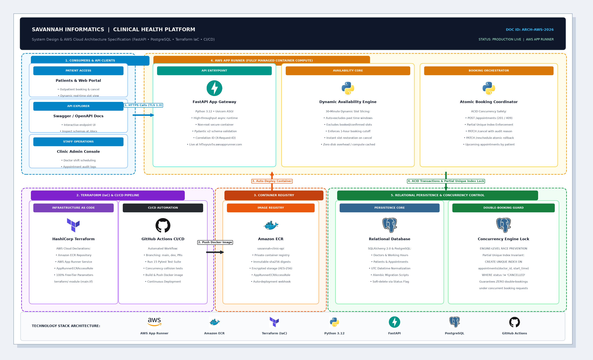
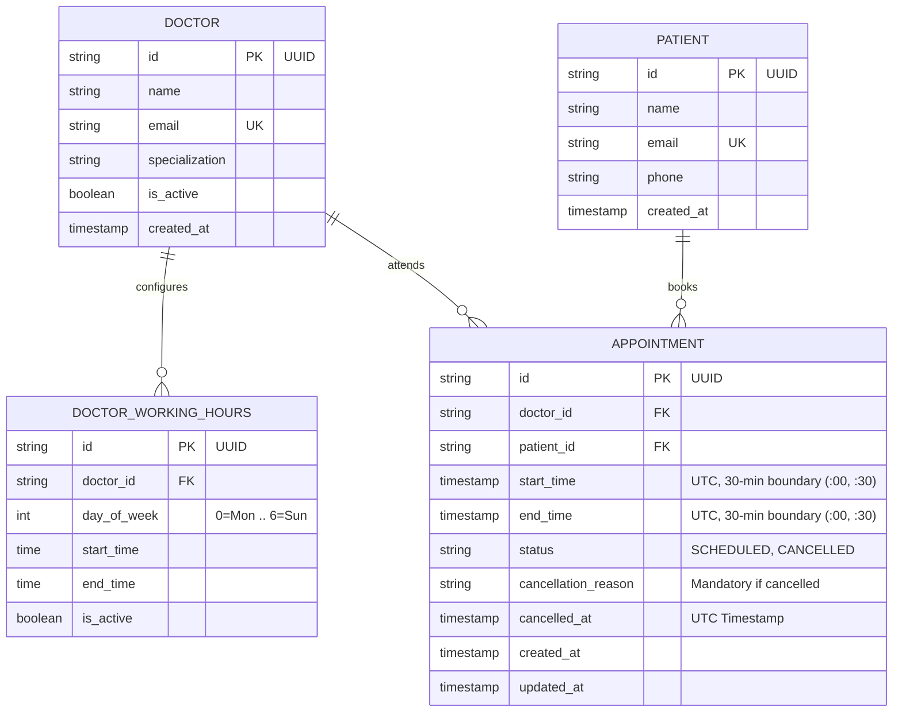

# Savannah Clinic Booking System API

<p align="left">
  
  &nbsp;
  <a href="https://claude.ai" target="_blank" rel="noreferrer">
    
  </a>
</p>

[](https://github.com/GeraldWambui/savannah-clinic-booking-api/actions/workflows/ci-cd.yml)
[](https://hf5vyszv5v.us-east-1.awsapprunner.com)
[](https://www.python.org/)
[](https://fastapi.tiangolo.com/)
[](https://www.terraform.io/)
[](https://www.postgresql.org/)
[](https://claude.ai)
[](tests/)

A robust, concurrency-safe REST API for outpatient appointment scheduling and dynamic doctor availability. Built for the **Savannah Informatics Backend Developer Take-Home Assessment**.

---

## Executive Summary & Live Endpoints

The system is deployed and operating live on **Amazon Web Services (AWS)** using **AWS App Runner** and **Amazon Elastic Container Registry (ECR)**, provisioned via **HashiCorp Terraform (IaC)**, and continuously verified through **GitHub Actions**.

| Service Component | Live Production URL | Description |
| :--- | :--- | :--- |
| **AWS App Runner (Live API)** | [https://hf5vyszv5v.us-east-1.awsapprunner.com](https://hf5vyszv5v.us-east-1.awsapprunner.com) | Zero-downtime containerized application gateway |
| **Interactive API Docs (Swagger UI)** | [https://hf5vyszv5v.us-east-1.awsapprunner.com/docs](https://hf5vyszv5v.us-east-1.awsapprunner.com/docs) | Interactive OpenAPI endpoint explorer & test client |
| **Alternative Docs (ReDoc)** | [https://hf5vyszv5v.us-east-1.awsapprunner.com/redoc](https://hf5vyszv5v.us-east-1.awsapprunner.com/redoc) | Clean specification reference documentation |
| **Health Check Endpoint** | [https://hf5vyszv5v.us-east-1.awsapprunner.com/health](https://hf5vyszv5v.us-east-1.awsapprunner.com/health) | Synthetic HTTP liveness & readiness probe (`HTTP 200`) |
| **GitHub Repository** | [https://github.com/GeraldWambui/savannah-clinic-booking-api](https://github.com/GeraldWambui/savannah-clinic-booking-api) | Public repository with automated CI/CD pipeline |

---

## Table of Contents

1. [Section 1: System Design](#section-1-system-design)
2. [Section 2: API Implementation & Local Setup](#section-2-api-implementation--local-setup)
3. [Section 3: AWS Cloud Deployment, Terraform (IaC) & CI/CD](#section-3-aws-cloud-deployment-terraform-iac--cicd)
4. [Section 4: AI Reflection](#section-4-ai-reflection)

---

## Section 1: System Design

### 1. Scenario & Domain Scope
The clinic operates with 5 doctors. Patients schedule 30-minute consultation appointments online based on each doctor's weekly working hours (e.g., Monday 09:00–17:00). A patient queries free slots for a doctor on a specific date, picks one, and books it. Once booked, that slot cannot be double-booked. Patients can also cancel or reschedule.

### 2. Architecture Specification



1. **Clients:** Web, mobile, and staff clients interact via HTTPS REST endpoints (`/docs` provides an interactive Swagger UI).
2. **FastAPI Application Gateway:** Validates incoming payloads with Pydantic v2 schemas and attaches an `X-Request-ID` correlation UUID.
3. **Dynamic Availability Engine:** Calculates open 30-minute slots in memory against doctor shift hours, excluding past times, active bookings, and enforcing the 1-hour booking cutoff.
4. **Atomic Booking Coordinator:** Manages transactional state transitions for booking, cancellation, and rescheduling.
5. **Relational Persistence (PostgreSQL / SQLite):** Enforces data integrity and concurrency safety via a partial unique index.

---

### 3. Entity-Relationship Schema



---

### 4. Key Architectural Decisions & Concurrency Guarantees

#### A. Dynamic Slot Slicing vs. Static Slot Pre-generation
- **Decision:** Compute 30-minute slots dynamically in memory on request: `Available = (Working Hours Slices) - (Active Bookings) - (Past Slots / 1h buffer)`.
- **Why:** Pre-generating future slots in database rows creates maintenance bloat. If a doctor modifies shift hours, falls ill, or takes leave, thousands of future rows require costly database updates. In-memory slicing runs in under 1ms, uses almost no memory, and completely avoids stale calendar data.

#### B. Concurrency Control & Double-Booking Prevention
- **Decision:** Enforce slot uniqueness at the database engine level with a **partial unique index**:
  ```sql
  CREATE UNIQUE INDEX uq_doctor_active_slot 
  ON appointments (doctor_id, start_time) 
  WHERE status != 'CANCELLED';
  ```
- **Why:** Application-level checks like `if not slot_taken:` fail under concurrency because two requests arriving at the same millisecond both pass the check before either commits (TOCTOU race condition). The database partial unique index rejects simultaneous duplicate inserts with an integrity violation. The API catches this violation and returns `409 Conflict`.
- **Verification:** Verified by `tests/test_concurrency.py` using 5 parallel threads firing simultaneously on the exact same slot: exactly 1 succeeds (`201 Created`) and 4 fail safely (`409 Conflict`).

#### C. Atomic Rescheduling with Rollback Safety
- **Decision:** Rescheduling updates `start_time` and `end_time` in place inside a single database transaction after validating the target slot.
- **Why:** The common approach of "cancel old booking, then book new one" is dangerous. If the second booking fails (e.g. taken by another patient), the patient loses their original appointment. Updating in place within a single transaction ensures that if the new slot fails, the transaction rolls back cleanly and the original booking stays intact.

#### D. Soft Cancellation with Audit History
- **Decision:** Appointments transition from `SCHEDULED` to `CANCELLED` with a required `cancellation_reason` and `cancelled_at` timestamp.
- **Why:** Healthcare records require an audit trail. Because the partial unique index filters on `WHERE status != 'CANCELLED'`, cancelling an appointment immediately restores the slot for new patient bookings without deleting historical data.

---

## Section 2: API Implementation & Local Setup

### 1. API Endpoints

All endpoints are available at the root and under `/api/v1`.

| Method | Endpoint | Description | Success | Error Codes |
| :--- | :--- | :--- | :--- | :--- |
| `POST` | `/appointments` | Book a 30-min slot | `201 Created` | `400`, `404`, `409 Conflict` |
| `GET` | `/doctors/{id}/availability` | List free slots for doctor on date | `200 OK` | `400`, `404 Not Found` |
| `PATCH` | `/appointments/{id}/cancel` | Cancel booking with reason | `200 OK` | `400`, `404`, `422 Unprocessable` |
| `PATCH` | `/appointments/{id}/reschedule` | Move booking to a new slot | `200 OK` | `400`, `404`, `409 Conflict` |
| `GET` | `/patients/{id}/appointments` | **(Bonus)** Patient's upcoming appointments | `200 OK` | `404 Not Found` |
| `GET` | `/health` | Health check probe | `200 OK` | `500 Server Error` |

#### Business Rules Handled:
- Slots must fall within the doctor's weekly working hours.
- Slots must align to `:00` or `:30` minute marks.
- Past dates/times are rejected.
- **Bonus:** Rejects bookings within 1 hour of the current time.
- Cancellations require a non-empty `reason` string and reject already-cancelled appointments.

---

### 2. Local Setup & Running

#### Option A: Python Virtual Environment
```bash
git clone https://github.com/GeraldWambui/savannah-clinic-booking-api.git
cd savannah-clinic-booking-api

python3.12 -m venv venv
source venv/bin/activate
pip install -r requirements.txt

alembic upgrade head
python scripts/seed_data.py

uvicorn app.main:app --reload
```


#### Option B: Docker Compose
```bash
docker-compose up --build
```
Boots PostgreSQL 16, runs Alembic migrations, seeds doctors, and serves API at port `8000`.

---

### 3. Automated Test Suite

```bash
pytest -v
```

15 tests pass across [`tests/`](tests/):
- **Availability (`test_availability.py`):** Dynamic 30-min slot generation, weekend handling, booked slot exclusion/restoration on cancel, 404s, `/health` probe.
- **Booking (`test_booking.py`):** Working hours, 30-min boundaries, past-time cutoff, 409 conflict on duplicate bookings, soft-cancellation audit, atomic rescheduling, upcoming patient bookings.
- **Concurrency (`test_concurrency.py`):** 5 parallel OS threads competing for the same slot (1 succeeds `201`, 4 reject `409`).


---

## Section 3: AWS Cloud Deployment, Terraform (IaC) & CI/CD

### 1. Cloud Infrastructure & Terraform (IaC)

All AWS infrastructure is codified in [`terraform/`](terraform/):
- `aws_ecr_repository.clinic_ecr`: Container registry with scan-on-push.
- `aws_iam_role.apprunner_ecr_role`: Least-privilege IAM access role for App Runner.
- `aws_apprunner_service.clinic_service`: Managed container service with health checks (1 vCPU, 2 GB RAM, Free Tier compliant).

To provision:
```bash
cd terraform
cp terraform.tfvars.example terraform.tfvars
terraform init
terraform apply
```

### 2. CI/CD Pipeline (`.github/workflows/ci-cd.yml`)

The repository uses **GitHub Actions** to automate quality checks and deployments:


- **Trigger 1 — Pull Requests (Testing Quality Gate):**
  - Runs on every pull request targeting `main`, `dev`, or `production`.
  - Executes the full 15-test Pytest suite (including multithreaded concurrency tests). Merging is blocked if any test fails.
- **Trigger 2 — Push / Merge (Continuous Deployment):**
  - Triggers on push or merge into `main` or `dev`.
  - Authenticates to AWS using GitHub Secrets, builds the Docker container, pushes to Amazon ECR, and triggers zero-downtime deployment on AWS App Runner.

---

## Section 4: AI Reflection

### 1. What did you use AI for across the four sections?
I used **Claude Code** as an AI pair programmer and typing accelerator for routine boilerplate:
- Drafting Pydantic v2 schema definitions and field validations.
- Generating the seed script with initial fixtures for the 5 doctors and working hours.
- Writing the initial syntax for the GitHub Actions workflow YAML and AWS App Runner Terraform blocks.
- Scaffolding the `ThreadPoolExecutor` fixture for the concurrency test.

### 2. Give one example where an AI suggestion improved your work. What did you prompt it with?
- **Prompt:** *"What is the cleanest way to store recurring weekly doctor working hours in a relational database without having to pre-populate calendar days?"*
- **Outcome:** The AI suggested storing shifts using weekday integers (`0=Monday` through `6=Sunday`) with `start_time` and `end_time` columns. This fit the dynamic availability approach well because it only requires ~5 rows per doctor instead of maintaining calendar tables.

### 3. Give one example where AI output was wrong or incomplete and how you caught it.
- **The Issue:** When prompted to write the booking logic, the AI generated this check:
  ```python
  if db.query(Appointment).filter_by(doctor_id=doc_id, start_time=slot, status="SCHEDULED").first():
      raise HTTPException(400, "Already booked")
  ```
- **How I caught it:** This check is vulnerable to a Time-of-Check to Time-of-Use (TOCTOU) race condition. If two requests hit the endpoint at the same millisecond, both pass the `if` check before either commits, creating a double-booking.
  I caught this by running a multithreaded test (`tests/test_concurrency.py`) with 5 parallel requests hitting the same slot. Under concurrency, both booked successfully. I fixed it by adding a partial unique database index (`(doctor_id, start_time) WHERE status != 'CANCELLED'`) and wrapping the insert with an `IntegrityError` handler that returns `409 Conflict`.

### 4. Name two decisions you made without AI. Why did you trust your own judgment there?
1. **Dynamic slot calculation instead of pre-populating a slots table:**  
   AI models almost always recommend creating a `slots` table with `is_available` boolean rows generated weeks ahead. In real clinic operations, this creates heavy maintenance: doctor shift changes, holidays, or emergency leaves force mass updates on future rows. Generating slots dynamically from working hours minus active bookings takes under 1ms and has zero data drift.
2. **In-place atomic rescheduling:**  
   Most AI-generated tutorials implement rescheduling as "cancel old appointment, then book new one". If the second step fails (slot taken or network error), the patient is left with a cancelled appointment and nothing booked. I made rescheduling update `start_time` directly in a single database transaction so that if anything fails, it rolls back cleanly and the original booking is preserved.

---

### Author & Engineering Details
- **Candidate:** Gerald Wambui
- **Assessment:** Savannah Informatics Backend Developer Take-Home Assessment
- **AI Tooling Used:** Claude Code (Anthropic)
- **Repository:** [https://github.com/GeraldWambui/savannah-clinic-booking-api](https://github.com/GeraldWambui/savannah-clinic-booking-api)
- **Live AWS Production API:** [https://hf5vyszv5v.us-east-1.awsapprunner.com](https://hf5vyszv5v.us-east-1.awsapprunner.com)
