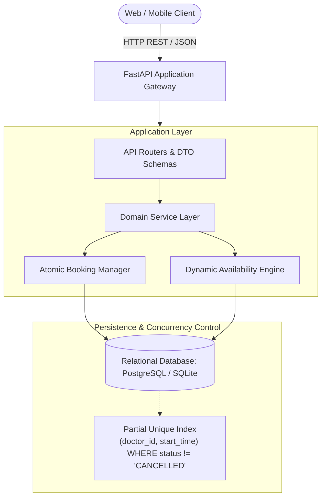
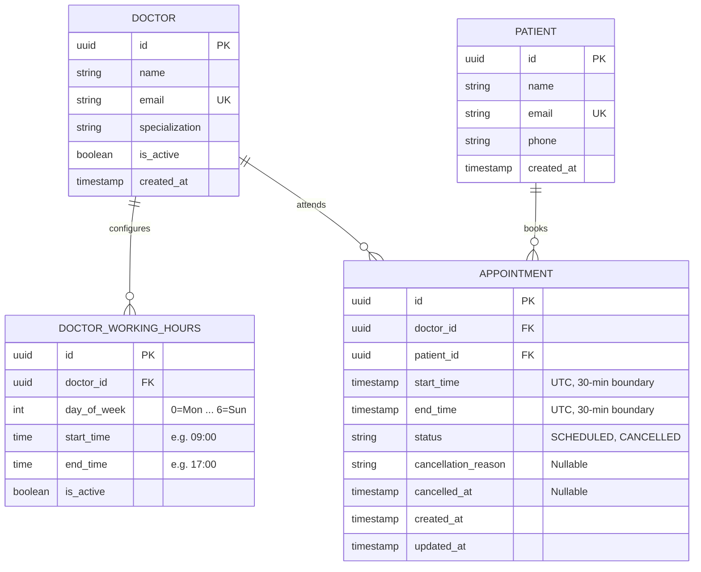

# Clinic Booking System API

A resilient, production-ready REST API for outpatient appointment scheduling and doctor availability management, designed for clinics scaling from 5 doctors to multi-facility health systems.

Built for the **Savannah Informatics Backend Developer Assessment**.

---

## Section 1: System Design

### 1. Domain Overview & Scenario
A primary care clinic operates with 5 doctors. Patients schedule 30-minute consultation appointments online. Each doctor defines recurring working hours. Patients view real-time open slots for a selected doctor on a specified date, book a slot, and retain the capability to cancel or reschedule.

### 2. Architectural Components



The system is structured in strict separation of concerns:
- **API & Schema Layer (`app/api`, `app/schemas`):** Handles HTTP contract enforcement, status codes, input sanitization via Pydantic v2, and dependency injection.
- **Domain Service Layer (`app/services`):** Pure business logic. Contains the dynamic slot calculation engine and transaction coordinator for booking/cancelling/rescheduling.
- **Persistence Layer (`app/models`, `app/db`):** Declarative SQLAlchemy 2.0 ORM with Alembic migrations, database-level integrity constraints, and transaction management.

---

### 3. Entity Models & Relational Schema



---

### 4. Key Architectural Decisions & Trade-offs

#### A. Dynamic Slot Generation vs. Static Slot Pre-generation
* **The Problem:** Many naive booking systems pre-populate database rows for every 30-minute interval weeks or months into the future.
* **The Pitfall:** If a doctor adjusts their weekly schedule, takes leave, or works overtime, thousands of future database rows must be deleted, recomputed, or updated under heavy table locks.
* **The Decision:** **Dynamic Slot Computation.**
  1. Working hours define recurring availability rules (e.g., Monday 09:00–17:00).
  2. On requesting `/doctors/{id}/availability?date=YYYY-MM-DD`, candidate 30-minute windows are generated in-memory.
  3. Active appointments for that doctor on that date are queried.
  4. Available slots = `Candidate Slots - Booked Slots - Past Slots (< 1h lead time)`.
* **Trade-off:** Minimal in-memory CPU computation (~16-32 slot iterations per query, sub-millisecond execution) eliminates storage bloat, synchronization bugs, and schedule migration nightmares.

#### B. Concurrency Control & Double-Booking Prevention
* **The Problem:** Two patients viewing the same free slot simultaneously submit booking requests at the same millisecond.
* **The Decision:** Multi-layer defensive locking:
  1. **Database Constraint Level (Ultimate Source of Truth):**
     A partial unique index guarantees that no two active appointments can share the same doctor and start time:
     ```sql
     CREATE UNIQUE INDEX uq_doctor_active_slot 
     ON appointments (doctor_id, start_time) 
     WHERE status != 'CANCELLED';
     ```
  2. **Application Transaction Level:**
     Booking operations run within explicit transactional isolation (`BEGIN ... COMMIT`). If a concurrent insert hits the partial unique constraint, the database aborts the transaction with an integrity violation, translated by the API into `409 Conflict` with a clean error message.

#### C. Atomic Rescheduling
* **The Problem:** Rescheduling involves two operations: relinquishing Slot A and claiming Slot B. A failure in claiming Slot B must never leave the patient without their original appointment.
* **The Decision:** Rescheduling is executed within a single database transaction:
  1. Fetch and lock the existing appointment.
  2. Validate it is not already cancelled.
  3. Validate the new slot (within working hours, not in past, not booked).
  4. Update `start_time` and `end_time` to the new slot.
  5. Commit atomically. If the new slot violates the unique constraint, the transaction rolls back cleanly, preserving the original booking intact.

#### D. Clinical Auditability: Soft Cancellation
* **The Problem:** In healthcare applications, clinical history and scheduling patterns cannot be destroyed via hard deletes.
* **The Decision:** Appointments use a state machine (`SCHEDULED` -> `CANCELLED`). Cancelled records retain `cancellation_reason` and `cancelled_at` timestamps for audit and compliance. Because the partial unique index only covers active appointments (`WHERE status != 'CANCELLED'`), cancelling immediately frees the slot for other patients.

#### E. Strict Timezone Normalization
* All datetimes are stored in UTC ISO-8601. Conversions to clinic operational hours (e.g., EAT / Nairobi UTC+3) occur deterministically during slot boundary checks.
