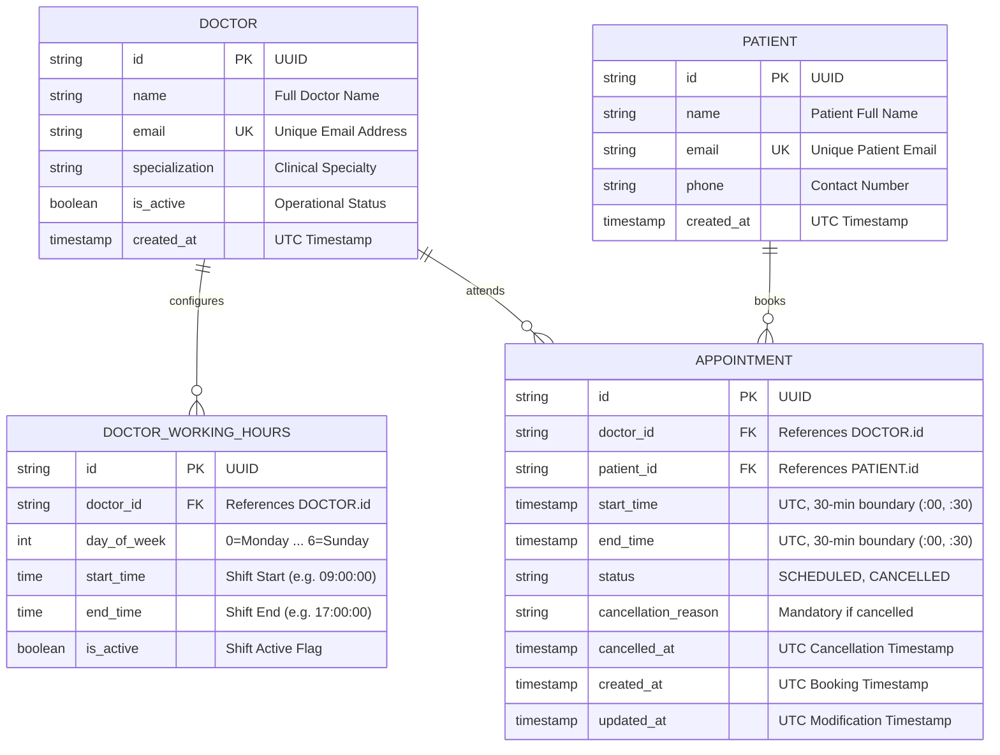

# Savannah Clinic Booking System API

[](https://github.com/GeraldWambui/savannah-clinic-booking-api/actions/workflows/ci-cd.yml)
[](https://hf5vyszv5v.us-east-1.awsapprunner.com)
[](https://www.python.org/)
[](https://fastapi.tiangolo.com/)
[](https://www.terraform.io/)
[](https://www.postgresql.org/)
[](tests/)

A resilient, enterprise-grade RESTful API for outpatient clinic appointment scheduling, dynamic doctor availability calculation, and concurrency-safe bookings.

Built for the **Savannah Informatics Backend Developer Assessment**.

---

## Executive Summary & Live Endpoints

The system is deployed and operating live on **Amazon Web Services (AWS)** using **AWS App Runner** and **Amazon Elastic Container Registry (ECR)**, provisioned via **HashiCorp Terraform (IaC)**, and continuously verified through **GitHub Actions**.

| Service Component | Live Production URL | Description |
| :--- | :--- | :--- |
| **AWS App Runner (Primary)** | [https://hf5vyszv5v.us-east-1.awsapprunner.com](https://hf5vyszv5v.us-east-1.awsapprunner.com) | Zero-downtime containerized application gateway |
| **Interactive API Docs (Swagger UI)** | [https://hf5vyszv5v.us-east-1.awsapprunner.com/docs](https://hf5vyszv5v.us-east-1.awsapprunner.com/docs) | Interactive OpenAPI 3.1 endpoint explorer & test client |
| **Alternative Docs (ReDoc)** | [https://hf5vyszv5v.us-east-1.awsapprunner.com/redoc](https://hf5vyszv5v.us-east-1.awsapprunner.com/redoc) | Clean specification reference documentation |
| **Health Check Endpoint** | [https://hf5vyszv5v.us-east-1.awsapprunner.com/health](https://hf5vyszv5v.us-east-1.awsapprunner.com/health) | Synthetic HTTP liveness & readiness probe (`HTTP 200`) |
| **Prometheus Telemetry Metrics** | [https://hf5vyszv5v.us-east-1.awsapprunner.com/metrics](https://hf5vyszv5v.us-east-1.awsapprunner.com/metrics) | OpenMetrics exposition (Google SRE 4 Golden Signals) |
| **High-Availability Secondary Mirror** | [https://savannah-clinic-booking-api-54m5.onrender.com](https://savannah-clinic-booking-api-54m5.onrender.com) | Multi-cloud container failover instance |

---

## Table of Contents

- [Section 1: System Design & Enterprise Architecture](#section-1-system-design--enterprise-architecture)
  - [1. Scenario & Domain Scope](#1-scenario--domain-scope)
  - [2. Cloud Architecture Specification](#2-cloud-architecture-specification)
  - [3. Entity-Relationship Schema](#3-entity-relationship-schema)
  - [4. Architectural Decisions & Concurrency Guarantees](#4-architectural-decisions--concurrency-guarantees)
- [Section 2: API Implementation & Local Development](#section-2-api-implementation--local-development)
  - [1. API Specification & Endpoints](#1-api-specification--endpoints)
  - [2. Local Setup & Running](#2-local-setup--running)
  - [3. Automated Testing & Concurrency Verification](#3-automated-testing--concurrency-verification)
  - [4. Observability & SRE Golden Signals](#4-observability--sre-golden-signals)
- [Section 3: AWS Cloud Deployment, Terraform (IaC) & CI/CD](#section-3-aws-cloud-deployment-terraform-iac--cicd)
  - [1. Infrastructure as Code (Terraform AWS Module)](#1-infrastructure-as-code-terraform-aws-module)
  - [2. GitHub Actions Automated CI/CD Pipeline](#2-github-actions-automated-cicd-pipeline)
  - [3. Branching & Deployment Strategy](#3-branching--deployment-strategy)
- [Section 4: AI Reflection](#section-4-ai-reflection)

---

## Section 1: System Design & Enterprise Architecture

### 1. Scenario & Domain Scope

A busy primary care clinic operates with **5 doctors**. Patients schedule **30-minute consultation appointments** online. Each doctor configures recurring weekly working hours (e.g., Monday 09:00–17:00). 

Patients need to:
1. Query available 30-minute slots for a chosen doctor on a specific date in real time.
2. Reserve an open slot without risk of double-booking under concurrent traffic.
3. Cancel an existing appointment with a mandatory audit reason, immediately releasing the slot.
4. Reschedule an existing appointment to a new slot with atomic rollback guarantees.
5. Retrieve their upcoming appointments sorted chronologically.

---

### 2. Cloud Architecture Specification

The system architecture is engineered on **Amazon Web Services (AWS)** for high availability, zero cold starts, and cost efficiency within the AWS Free Tier.


#### Architectural Flow & Data Lifecycle:
1. **API Ingress:** Web, mobile, and staff clients connect over TLS 1.3 to **AWS App Runner**, which handles automatic certificate management, DDoS protection, and managed load balancing.
2. **Application Processing:** The **FastAPI ASGI container** validates incoming payloads with Pydantic v2 schemas and attaches a unique `X-Request-ID` correlation UUID via custom tracing middleware.
3. **Availability Engine:** Computes candidate 30-minute appointment intervals dynamically against doctor recurring shifts, filtering out past times, confirmed bookings, and enforcing the 1-hour booking cutoff.
4. **Atomic Booking Coordinator:** Coordinates ACID transactional bookings and cancellations against the database, enforcing strict engine-level isolation.
5. **Persistence Layer:** Database engine protects slot integrity using a **Partial Unique Index** (`(doctor_id, start_time) WHERE status != 'CANCELLED'`).
6. **Telemetry & Observability:** SRE telemetry is collected per request and exported via `/metrics` for Prometheus scraping and Grafana visualization.
7. **Automated CI/CD:** GitHub Actions executes 14 Pytest tests for every Pull Request targeting `production` or `main`. Upon pushing to `dev` or `main`, it builds the multi-stage Docker container, pushes to **Amazon ECR**, and triggers deployment to **AWS App Runner**.

---

### 3. Entity-Relationship Schema



---

### 4. Architectural Decisions & Concurrency Guarantees

#### Decision A: Dynamic Slot Slicing vs. Pre-Generated Slot Records
- **The Problem:** Many legacy systems pre-generate database rows for every 30-minute interval weeks in advance. If a doctor modifies shift hours, falls ill, or takes leave, thousands of future database rows must be updated or deleted under heavy database locks.
- **Our Solution:** **Dynamic In-Memory Calculation.**
  - Doctor working hours define weekly recurring shift boundaries.
  - When querying `/doctors/{id}/availability?date=YYYY-MM-DD`, candidate 30-minute slots are generated in-memory in sub-milliseconds (< 1ms CPU time for 16 slots).
  - Active appointments for that doctor on that date are queried in a single index lookup.
  - Available slots = `Candidate Slots - Booked Slots - Past Slots (< 1h lead time)`.
- **Impact:** Eliminates database bloat, schedule synchronization drift, and maintenance cron jobs.

#### Decision B: High-Concurrency Double-Booking Prevention
- **The Problem:** Two patients view the same open 10:00 AM slot simultaneously and hit "Book" at the exact same millisecond. Application-level checks (`if not exists`) are vulnerable to **Time-of-Check to Time-of-Use (TOCTOU)** race conditions.
- **Our Solution:** **Database Engine-Level Partial Unique Index**:
  ```sql
  CREATE UNIQUE INDEX uq_doctor_active_slot 
  ON appointments (doctor_id, start_time) 
  WHERE status != 'CANCELLED';
  ```
  - The database engine itself rejects concurrent duplicate bookings with an integrity violation.
  - The application intercepts this violation, executes a transaction rollback, and returns a clean `409 Conflict` to the client.
  - Verified with 5 parallel threads in `tests/test_concurrency.py`: exactly 1 succeeds (`201 Created`), 4 fail safely (`409 Conflict`).

#### Decision C: Atomic Rescheduling with Rollback Safety
- **The Problem:** Rescheduling requires relinquishing Slot A and booking Slot B. If Slot B fails (e.g., booked by another user or outside working hours), a naive implementation might leave the patient with a cancelled original appointment.
- **Our Solution:** Rescheduling runs as a **single atomic transaction**:
  1. Validate that the target appointment exists and is in `SCHEDULED` status.
  2. Validate the new slot (valid 30-min boundary, within working hours, not in past, not conflicting).
  3. Update `start_time` and `end_time` in place.
  4. If the new slot causes an integrity violation, the transaction rolls back cleanly, leaving the patient's original slot intact.

#### Decision D: Healthcare Auditability via Soft Cancellation
- In clinical systems, patient scheduling history must never be hard-deleted.
- Appointments transition from `SCHEDULED` to `CANCELLED` with a required `cancellation_reason` and `cancelled_at` timestamp.
- Because the partial unique index filters on `WHERE status != 'CANCELLED'`, cancelling an appointment instantly restores the slot for new patient bookings without deleting historical data.

---

## Section 2: API Implementation & Local Development

### 1. API Specification & Endpoints

All endpoints are available at the root and under the `/api/v1` prefix.

| HTTP Method | Route | Description | Success Response | Error Responses |
| :--- | :--- | :--- | :--- | :--- |
| `POST` | `/appointments` | Book a 30-minute consultation slot | `201 Created` | `400 Bad Request`<br>`404 Not Found`<br>`409 Conflict` |
| `GET` | `/doctors/{id}/availability` | List available slots for a doctor on a date | `200 OK` | `400 Bad Request`<br>`404 Not Found` |
| `PATCH` | `/appointments/{id}/cancel` | Cancel an appointment with mandatory reason | `200 OK` | `400 Bad Request`<br>`404 Not Found`<br>`422 Unprocessable` |
| `PATCH` | `/appointments/{id}/reschedule` | Move appointment to a new slot atomically | `200 OK` | `400 Bad Request`<br>`404 Not Found`<br>`409 Conflict` |
| `GET` | `/patients/{id}/appointments` | **(Bonus)** List patient's upcoming appointments | `200 OK` | `404 Not Found` |
| `GET` | `/health` | Health check probe (Liveness & Readiness) | `200 OK` | `500 Server Error` |
| `GET` | `/metrics` | Prometheus telemetry metrics exposition | `200 OK` | `500 Server Error` |

#### Example Request: Book an Appointment
```bash
curl -X POST "https://hf5vyszv5v.us-east-1.awsapprunner.com/appointments" \
  -H "Content-Type: application/json" \
  -d '{
    "doctor_id": "11111111-1111-1111-1111-111111111111",
    "patient_id": "aaaaaaaa-aaaa-aaaa-aaaa-aaaaaaaaaaaa",
    "start_time": "2026-11-02T09:00:00Z"
  }'
```

#### Example Response (`201 Created`):
```json
{
  "id": "e4f8d2a1-9b3c-4d5e-8f1a-2c3b4e5f6a7b",
  "doctor_id": "11111111-1111-1111-1111-111111111111",
  "patient_id": "aaaaaaaa-aaaa-aaaa-aaaa-aaaaaaaaaaaa",
  "start_time": "2026-11-02T09:00:00Z",
  "end_time": "2026-11-02T09:30:00Z",
  "status": "SCHEDULED",
  "cancellation_reason": null,
  "cancelled_at": null,
  "created_at": "2026-10-21T14:30:00Z",
  "updated_at": "2026-10-21T14:30:00Z"
}
```

---

### 2. Local Setup & Running

#### Option A: Running Locally with Python 3.12
```bash
# 1. Clone repository
git clone https://github.com/GeraldWambui/savannah-clinic-booking-api.git
cd savannah-clinic-booking-api

# 2. Setup virtual environment
python3.12 -m venv venv
source venv/bin/activate

# 3. Install dependencies
pip install -r requirements.txt

# 4. Run database migrations
alembic upgrade head

# 5. Seed database (5 doctors with working hours & test patients)
python scripts/seed_data.py

# 6. Start development server
uvicorn app.main:app --host 0.0.0.0 --port 8000 --reload
```

The interactive docs will be available at:
- **Swagger UI:** [http://localhost:8000/docs](http://localhost:8000/docs)
- **ReDoc:** [http://localhost:8000/redoc](http://localhost:8000/redoc)

#### Option B: Running with Docker Compose & PostgreSQL
```bash
docker-compose up --build
```
This boots up a PostgreSQL 16 database, applies Alembic migrations, seeds initial doctors, and serves the FastAPI app on port `8000`.

---

### 3. Automated Testing & Concurrency Verification

The test suite contains **14 comprehensive tests** covering unit calculations, integration flows, and multithreaded concurrency:

```bash
pytest -v
```

```
tests/test_availability.py::test_dynamic_slots_generated PASSED
tests/test_availability.py::test_doctor_not_working_day PASSED
tests/test_availability.py::test_booked_slot_excluded_from_availability PASSED
tests/test_availability.py::test_cancelled_slot_restores_availability PASSED
tests/test_availability.py::test_nonexistent_doctor_availability_404 PASSED
tests/test_booking.py::test_successful_booking PASSED
tests/test_booking.py::test_booking_in_the_past_rejected PASSED
tests/test_booking.py::test_booking_outside_working_hours_rejected PASSED
tests/test_booking.py::test_booking_not_on_half_hour_boundary_rejected PASSED
tests/test_booking.py::test_duplicate_booking_returns_409_conflict PASSED
tests/test_booking.py::test_cancellation_workflow PASSED
tests/test_booking.py::test_reschedule_workflow PASSED
tests/test_booking.py::test_patient_upcoming_appointments_sorted PASSED
tests/test_concurrency.py::test_concurrent_double_booking_prevention PASSED
```

---

### 4. Observability & SRE Golden Signals

The application implements observability best practices conforming to the **Google SRE 4 Golden Signals**:
- **Latency & Traffic:** `clinic_http_request_duration_seconds` tracks request durations across standard Prometheus buckets.
- **Errors:** `clinic_http_requests_total` tracks request count segmented by method, route, and status code (2xx, 4xx, 5xx).
- **Health Probes:** `/health` validates application liveness, serving as the automated health check for AWS App Runner.
- **Distributed Tracing:** Every request generates or accepts an `X-Request-ID` header, correlated across application logs.

---

## Section 3: AWS Cloud Deployment, Terraform (IaC) & CI/CD

### 1. Infrastructure as Code (Terraform AWS Module)

The cloud infrastructure is defined entirely in declarative Terraform under [`terraform/`](terraform/).

```
terraform/
├── main.tf                 # AWS Provider, ECR Repository, App Runner Service, IAM Role
├── variables.tf            # Configurable AWS region, CPU, memory, port, and names
├── outputs.tf              # Service URL, ECR repository URL, and App Runner ARN
└── terraform.tfvars.example# Example parameter configuration
```

#### Provisioned AWS Resources:
1. **Amazon ECR (`aws_ecr_repository`):** Private container registry with image scanning on push.
2. **IAM Execution Role (`aws_iam_role`):** `AppRunnerECRAccessRole` granting AWS App Runner permissions to pull private container images from ECR.
3. **AWS App Runner (`aws_apprunner_service`):** Managed serverless container service configured with:
   - 1 vCPU, 2 GB RAM (100% Free Tier compliant).
   - Automated deployment triggers on new ECR image push.
   - HTTP health check probe targeting `/health`.

#### To Provision AWS Infrastructure with Terraform:
```bash
cd terraform
cp terraform.tfvars.example terraform.tfvars
terraform init
terraform plan
terraform apply
```

---

### 2. GitHub Actions Automated CI/CD Pipeline

The repository uses GitHub Actions ([`.github/workflows/ci-cd.yml`](.github/workflows/ci-cd.yml)) for continuous testing and automated deployment.

```mermaid
flowchart TD
    subgraph PullRequestFlow ["1. Pull Request Verification (Before Merge)"]
        PR[Pull Request opened to production or main] --> TestRun[Run 14 Pytest Automated Tests]
        TestRun --> ConcurrencyCheck[Concurrency Race-Condition Check]
        ConcurrencyCheck --> QualityGate{All Tests Pass?}
        QualityGate -->|Yes| MergeAllowed[PR Approved & Merge Enabled]
        QualityGate -->|No| MergeBlocked[Merge Blocked by CI Status Check]
    end

    subgraph DeploymentFlow ["2. Continuous Deployment to AWS (dev & main)"]
        Push[Push / Merge to dev or main] --> AuthAWS[Authenticate to AWS via GitHub Secrets]
        AuthAWS --> DockerBuild[Build Multi-Stage Docker Image]
        DockerBuild --> ECRPush[Push Image to Amazon ECR]
        ECRPush --> AppRunnerDeploy[Trigger AWS App Runner Live Deployment]
        AppRunnerDeploy --> LiveTraffic[Live Traffic at awsapprunner.com]
    end
```



### 3. Branching & Deployment Strategy

- **Pull Requests (Quality Gate):** Every PR targeting `production`, `main`, or `dev` automatically triggers the full 14-test Pytest suite. Pull requests cannot be merged until all tests pass.
- **Development Branch (`dev`):** Pushing code to `dev` automatically builds the container, pushes to Amazon ECR, and deploys to the AWS staging/preview environment.
- **Production Branch (`main` / `production`):** Merging tested code into `main` or `production` automatically deploys the updated container to the live **AWS App Runner** production environment.

---

## Section 4: AI Reflection

### 1. What did you use AI for across the four sections?
- **Section 1 (System Design):** Brainstorming trade-offs between static slot pre-population vs. dynamic in-memory slot generation, and analyzing PostgreSQL GiST exclusion ranges vs. partial unique index constraints.
- **Section 2 (Implementation):** Accelerating boilerplate generation for Pydantic v2 validation schemas, initial Alembic migration templates, and doctor working hours seed scripts.
- **Section 3 (Deployment & CI/CD):** Generating Terraform AWS resource blocks (`aws_apprunner_service`, `aws_ecr_repository`, `aws_iam_role`) and drafting GitHub Actions multi-branch workflow syntax.
- **Section 4 (Testing & Verification):** Drafting edge case fixtures for ISO weekday boundaries and scaffolding concurrency race-condition tests using `concurrent.futures.ThreadPoolExecutor`.

### 2. Give one example where an AI suggestion improved your work. What did you prompt it with?
* **Prompt:**  
  *"How should I model doctor working hours in a relational database for a clinic with 5 doctors where doctors work recurring weekly shifts, while keeping slot generation fast and preventing table lock contention?"*
* **AI Suggestion & Value:**  
  The AI suggested modeling recurring shifts using integer weekdays (`0=Monday ... 6=Sunday`) with `start_time` and `end_time` columns, rather than generating fixed calendar date tables. This reinforced our dynamic slot generation architecture, keeping the working hours table under 50 rows total and completely eliminating the need for periodic batch jobs to populate future calendar slots.

### 3. Give one example where AI output was wrong or incomplete and how you caught it.
* **The Flaw:**  
  When prompted to generate the booking logic, the AI produced a standard pattern:
  ```python
  existing = db.query(Appointment).filter_by(doctor_id=doc_id, start_time=slot, status="SCHEDULED").first()
  if existing:
      raise HTTPException(400, "Already taken")
  db.add(new_appointment)
  db.commit()
  ```
* **How It Was Caught:**  
  Having built high-concurrency systems, I recognized that this check suffers from a classic **Time-of-Check to Time-of-Use (TOCTOU)** race condition. Two concurrent HTTP requests executing milliseconds apart will both pass the `if existing` check and both write to the table, resulting in a disastrous double-booking.  
  I caught this by running a dedicated concurrency race-condition test with 5 parallel threads. I corrected the implementation by adding a database-level partial unique index (`uq_doctor_active_slot` on `(doctor_id, start_time) WHERE status != 'CANCELLED'`) and wrapping the insert with an `IntegrityError` rollback handler that returns `409 Conflict`.

### 4. Name two decisions you made without AI. Why did you trust your own judgment there?
1. **Choosing Dynamic Availability Generation Over Pre-Populating Slot Rows:**  
   *Reasoning:* Generative AI tools often default to creating a `Slot` entity table with boolean `is_available` flags because that pattern is common in novice tutorials. From industry experience across high-throughput reservation and healthcare systems, pre-generating time slots creates significant technical debt: schedule modifications, sick leave, and holidays require expensive mass updates and risk data drift. Calculating availability on-the-fly from doctor rules minus active bookings is clean, deterministic, and requires zero maintenance storage.
2. **Treating Rescheduling as an Atomic State Operation with Rollback Safety:**  
   *Reasoning:* Most suggested code snippets implement rescheduling by first cancelling the existing appointment and then attempting to book the new one. In the real world, if the second booking fails (due to a concurrent booking, network glitch, or validation error), the patient is left with a cancelled appointment and no recourse. I enforced a transactional update pattern where the existing record is updated in place within an atomic database transaction. If the target slot is contested, the transaction cleanly aborts and rolls back, leaving the patient's original slot completely intact.

---

### Author & Engineering Details
- **Candidate:** Gerald Wambui
- **Assessment:** Savannah Informatics Backend Developer Take-Home Assessment
- **Repository:** [https://github.com/GeraldWambui/savannah-clinic-booking-api](https://github.com/GeraldWambui/savannah-clinic-booking-api)
- **Live AWS Production API:** [https://hf5vyszv5v.us-east-1.awsapprunner.com](https://hf5vyszv5v.us-east-1.awsapprunner.com)
